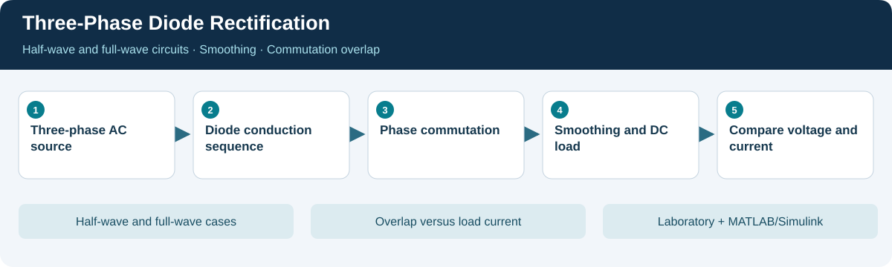
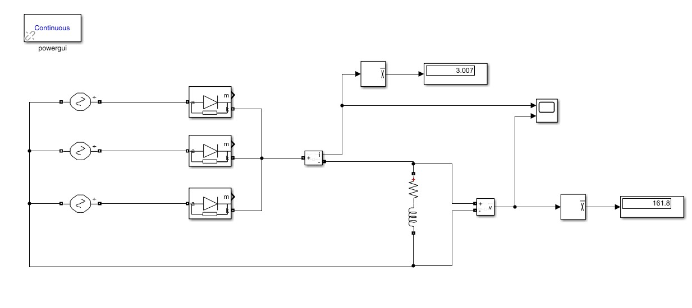
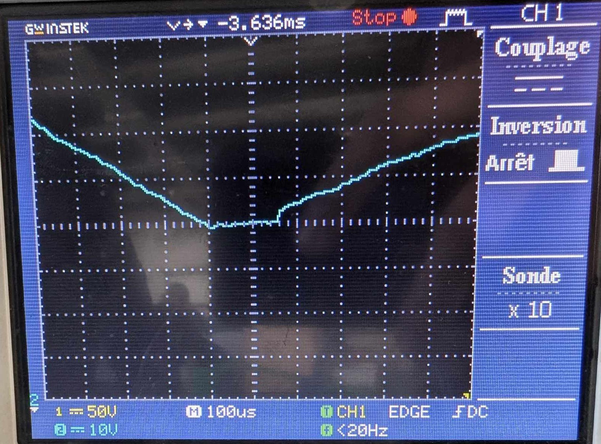

# Three-Phase Diode Rectification

**Half-wave and full-wave circuits · Smoothing · Commutation overlap**

A practical and simulation study of three-phase diode rectifiers. The project follows the conversion from three-phase AC to DC, then investigates how load current, smoothing and source inductance affect voltage and commutation.

Power-electronics group project at the National Polytechnic School of Algiers, 2024/2025.  
**Author:** Amani Mouaad · **Supervision:** Pr. M. Mahmoudi and Mr. Benachour.

## From phase voltages to a DC output

Diodes conduct according to the instantaneous phase voltages. As the phase ordering changes, current transfers from one diode path to the next. The resulting output is unidirectional but contains ripple. Smoothing elements reduce the variation seen by the load.

| Configuration | Operating idea |
|---|---|
| Three-phase half-wave | The conducting path follows the appropriate phase-to-neutral voltage |
| Three-phase full-wave bridge | Upper and lower diode groups connect the most positive and most negative phases |
| Source inductance included | Current transfer takes a finite commutation interval |

## Circuit diagram

See the [French report](diode-rectifier-report-fr.pdf) for the individual circuit cases and measurement setup.

## Useful reference equations

For ideal diodes and continuous conduction, the mean output of the three-phase half-wave rectifier is:

$$V_{DC}=\frac{3\sqrt6}{2\pi}V_{phase,rms}$$

For the full-wave six-pulse bridge:

$$V_{DC}=\frac{3\sqrt2}{\pi}V_{LL,rms}\simeq1.35V_{LL,rms}$$

Source inductance prevents phase current from changing instantaneously. During commutation, two paths share current for an overlap angle $\mu$. The overlap and the average-voltage change can therefore be studied as load current increases.

## Experimental waveform capture

The report compares measured rectified voltages, current waveforms and commutation behavior with calculations and simulation.

The analysis script includes the following load-current and mean-voltage data:

| Current | Recorded mean voltage |
|---|---:|
| 1.5 A | 156 V |
| 3.0 A | 155 V |
| 5.1 A | 153 V |
| 5.7 A | 152 V |
| 7.0 A | 151 V |

These are the data points embedded in `rectifier-analysis.m`; the report provides the circuit context. The same script contains overlap-angle data and a source-reactance calculation.

## Why these comparisons

Half-wave and full-wave operation show how the conduction sequence changes output ripple. Smoothing reveals the relationship between the switched voltage and load current. Adding the source-inductance perspective explains why real phase-to-phase current transfer occupies a finite interval.

## Explore the project

1. Read [diode-rectifier-report-fr.pdf](diode-rectifier-report-fr.pdf).
2. Open `diode_rectifier.slx` in MATLAB/Simulink and inspect the operating case.
3. Inspect `rectifier-analysis.m` alongside the report’s overlap and voltage measurements.
4. Extract [results-and-waveforms.zip](results-and-waveforms.zip) for the complete figure collection.

## Files and tools

| File | Contents |
|---|---|
| `diode_rectifier.slx` | Editable rectifier circuit |
| `rectifier-analysis.m` | Measurement arrays and analytical comparisons |
| [Report](diode-rectifier-report-fr.pdf) | Theory, experiments and simulations |
| [Waveform archive](results-and-waveforms.zip) | Additional recorded figures |

**Tools:** MATLAB, Simulink, power-system blocks and numerical curve calculations.

## Related projects

[Thyristor Rectifier and DC Motor](https://github.com/MouaadO/thyristor-rectifier-dc-motor) · [Inverter Modulation and PWM](https://github.com/MouaadO/inverter-pwm-experimental-validation)
