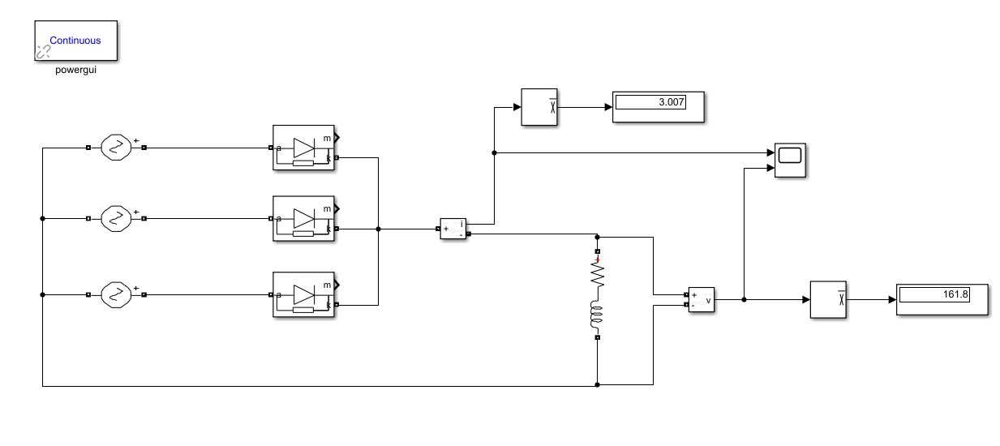
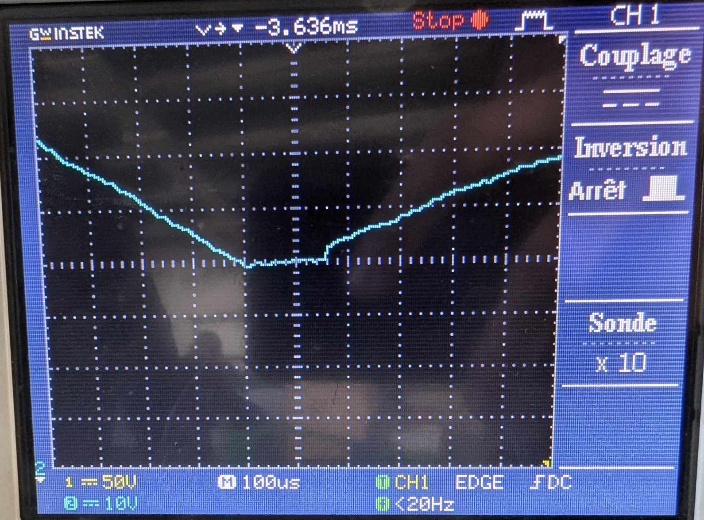

# Three-Phase Diode Rectifier

Practical implementation of three-phase diode rectifiers. I studied smoothing and commutation overlap through laboratory measurements, MATLAB calculations and Simulink simulations.

## Practical implementation and experimental validation

- Studied laboratory half-wave and full-wave three-phase rectifier configurations.
- Measured rectified voltage and investigated commutation overlap as load current varied.
- Analysed voltage/current waveforms and the influence of smoothing and leakage inductance.
- Compared practical measurements with theoretical calculations and simulation waveforms.

### Simulation circuit

### Experimental waveform capture

Oscilloscope measurements from the practical work. Circuit settings and measurement conditions are given in the report.

## Repository contents

| File | Purpose |
| --- | --- |
| [diode-rectifier-report-fr.pdf](diode-rectifier-report-fr.pdf) | Full French report: experimental setup, measurements, calculations and simulation comparisons. |
| [results-and-waveforms.zip](results-and-waveforms.zip) | Circuit diagrams, waveforms and spectra. |
| [simulation-diagram.jpg](simulation-diagram.jpg) | Simulation circuit diagram. |
| [diode_rectifier.slx](diode_rectifier.slx) | Editable Simulink model. |
| [rectifier-analysis.m](rectifier-analysis.m) | MATLAB analysis script. |

## Getting started

1. Read the French report to understand the circuit, operating conditions and measurement protocol.
2. Extract `results-and-waveforms.zip` to inspect the recorded results and simulation figures.
3. Open `diode_rectifier.slx` in MATLAB/Simulink and inspect the configured circuit and parameters before running it.
4. Use the report to select the operating case to reproduce and compare the voltage/current waveforms.

## Software requirements

MATLAB and Simulink. The circuit models use power-system blocks. Scripts using `syms` or `vpasolve` also require Symbolic Math Toolbox.

## Project context

Power-electronics group project completed at the National Polytechnic School of Algiers in 2024/2025, combining practical laboratory work and simulation.

**Author:** Amani Mouaad  
**Supervision:** Pr. M. Mahmoudi and Mr. Benachour.

The report is in French.
